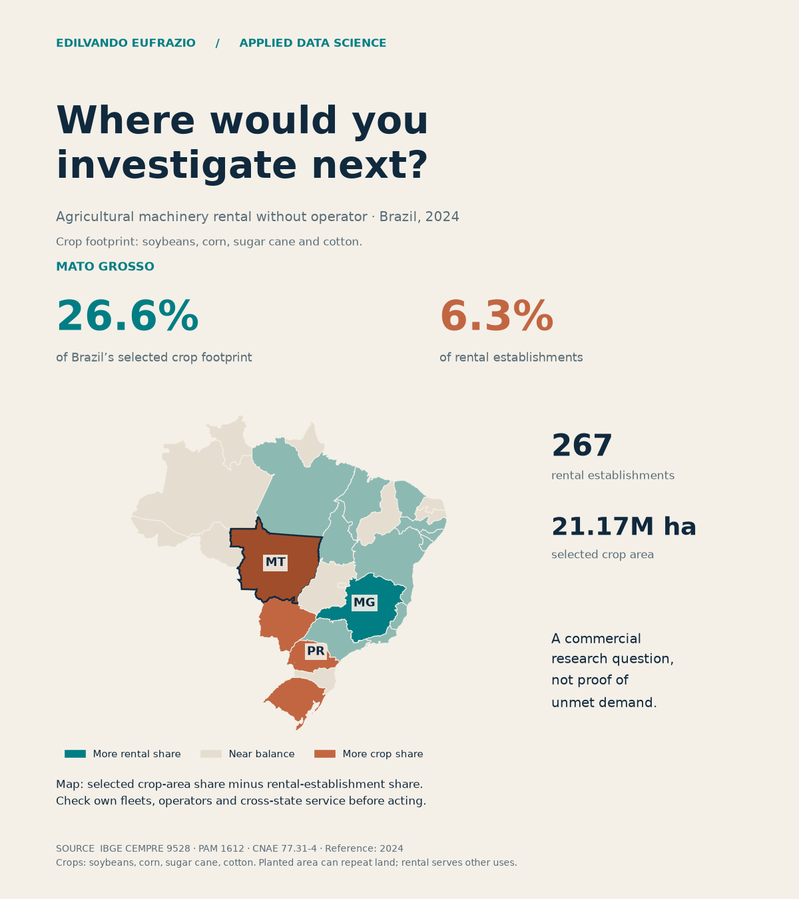

# Agri Rental Atlas

[Explore the public portal](https://edilvandopereira-dot.github.io/agri-rental-atlas/) · [English post for review](https://edilvandopereira-dot.github.io/agri-rental-atlas/post-review.html)


An independent personal portfolio by Edilvando Eufrazio. A reproducible public-data screen for agricultural rental businesses, with explicit planning scenarios for rental operators and farm managers.

## Current delivery — 20 October 2026

Repository: [edilvandopereira-dot/agri-rental-atlas](https://github.com/edilvandopereira-dot/agri-rental-atlas).

Portal address: [Agri Rental Atlas](https://edilvandopereira-dot.github.io/agri-rental-atlas/). Deployment verification is recorded separately in `assets/publication.json`.

Local build: `docs/index.html`.

- Portuguese, English and Simplified Chinese: translated charts, explanations, accessibility labels and locale-aware number formatting. Language preference persists locally; changing language preserves filters and scenario inputs. Official state names, CNAE and source identifiers are preserved.
- Market geography: 27 state-level units × 2022–2024, national denominators, selectable state map, paired-share comparison, state history, sortable table and downloadable JSON.
- Rental economics: user-entered costs, utilisation, target margin and optional quote; required day rate, quoted-rate margin and break-even days. The example button loads fictional assumptions explicitly labelled as such.
- Farm work window: area, effective machine capacity, own fleet, usable days and charged rental days; machine requirements, additional rental units and estimated rental cost. No weather forecast is implied.
- Exchange reference: direct European Central Bank data API, BRL/USD/CNY cross rates from a common EUR base and aligned date. The browser checks on load, manual refresh and every 15 minutes while visible. The ECB publishes daily reference rates, **not live tradable quotes**. All monetary inputs remain BRL; outputs may be displayed in BRL, USD or CNY. No spread or transaction fee is included.
- Exchange reliability: HTTP timeout, schema/positive-value/aligned-date validation; timestamped last-success cache; explicit cached/stale/unavailable state. Currency conversion is disabled when no valid reference exists or the rate is more than four calendar days old. That threshold is an application policy, not an ECB publication guarantee. Core IBGE exploration works offline; fresh exchange data requires internet.

## Official sources and scope

- [IBGE CEMPRE 9528](https://sidra.ibge.gov.br/tabela/9528): CNAE 77.31-4, agricultural machinery rental **without operator**, local units (variable 706) and employment (707).
- [IBGE CEMPRE 9418](https://sidra.ibge.gov.br/tabela/9418): national enterprise counts (2585). Enterprises are not local units.
- [IBGE PAM 1612](https://sidra.ibge.gov.br/tabela/1612): planted hectares (109), soybean grain, grain corn, sugar cane and herbaceous cotton.
- [IBGE boundaries](https://servicodados.ibge.gov.br/api/docs/malhas?versao=3): simplified state geometry.
- [ECB reference-rate definitions](https://www.ecb.europa.eu/stats/policy_and_exchange_rates/euro_reference_exchange_rates/html/index.en.html).
- Runtime exchange endpoint: `https://data-api.ecb.europa.eu/service/data/EXR/D.USD+BRL+CNY.EUR.SP00.A?lastNObservations=1&format=csvdata`.

CEMPRE observations are annual statistical snapshots, not current advertisements, machines, fleet availability, rental transactions, revenues or market size. Use 2022–2024 under the newer methodology. Do not splice the older series.

Four-crop area is selected production context, not total agricultural demand or unique physical land. Double cropping can count the same land repeatedly. Rental businesses also serve omitted crops and other agricultural uses. Primary-activity registrations omit other business models, including services with operator. A unit can serve neighbouring states.

Mato Grosso has **26.57% of the four-crop area and 6.26% of the establishments in 2024**. That is a question for field validation, not proof of unmet demand or an investment recommendation. No arbitrary opportunity score is generated.

## Reproduction

Uses Python standard library; the HTML embeds the licensed Chart.js bundle and all pinned market data.

```sh
python3 scripts/build.py
python3 -m unittest discover -s tests -v
node --test tests/test_models.cjs
```

`scripts/fetch_data.py` creates the initial pinned IBGE snapshot and refuses to overwrite an existing manifest. `data/raw/manifest.json` records URLs, retrieval times and SHA256 hashes. The build verifies these hashes and writes `market.json`, `state_year_base.csv`, `market.sqlite` and a standalone HTML file.

Validation: 81 state-years, 324 crop-state-years, 15 exact national reconciliations and three employment known-subtotal checks because some values are suppressed. Missing and suppressed values remain null; the IBGE dash representing absolute zero is zero. Aggregate crops by state/year **before** joining to rental units to avoid multiplying establishments by four.

`web/models.js` contains the actual browser calculation and exchange parser used by the Node tests. The pinned ECB CSV in `tests/fixtures` is for parser testing only; it is not a hidden runtime fallback.

## Decision logic

Rental day rate = (monthly fixed + monthly logistics + variable/day × billable days) ÷ [billable days × (1 − target revenue margin)]. Break-even days = ceiling[(fixed + logistics) ÷ (quoted day rate − variable/day)], unavailable when contribution is nonpositive. A break-even above available days is identified.

Required machines = ceiling[area ÷ (effective ha/hour × hours/day × usable days)]. Additional rentals = max(0, required − own available). Rental cost = additional × (quote/day × charged days + freight/machine). Machines are treated as equivalent and available throughout the window; the charged period must cover the usable days. Effective capacity already incorporates field losses. Include missing fuel, operator, taxes and other items in an actual business comparison.

## Next data layer

Collect comparable, permissioned quotes with timestamp, municipality, machine type/model/specification, operator, fuel, transport, hour allowance, duration, taxes and availability. Preserve quote evidence and distinguish asking rates from completed contracts. Do not fill unknown prices with invented benchmarks. Validate the operational assumptions with field users before extending to optimisation or forecasting.

## Publication status

Published on GitHub Pages and verified on 20 October 2026. The approved English post was published and verified on 20 October 2026: [read the LinkedIn post](https://www.linkedin.com/feed/update/urn:li:share:7518410396161011712/). New posts require Edilvando’s review; the first soybean post’s authorization does not extend to subsequent posts.

## Editorial figure


